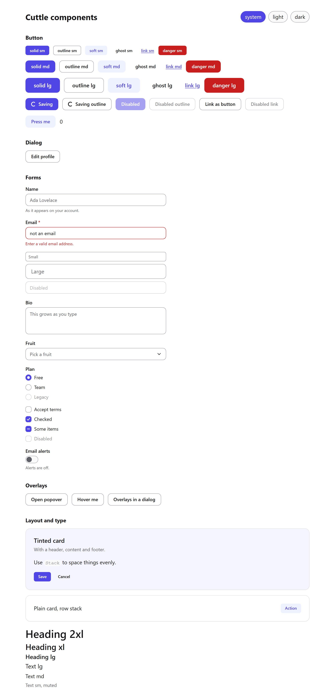

# Cuttle UI

Simple, catchy, accessible UI components for every framework.

<picture>
  <source media="(prefers-color-scheme: dark)" srcset="docs/assets/showcase-dark.png">
  
</picture>

> **Not released yet.** Nothing is published to npm, so the install commands in the docs do not work yet. The components have automated accessibility tests, but have not been tested with a screen reader. See [project status](docs/roadmap/STATUS.md) and the [roadmap](docs/roadmap/README.md).

**[Read the documentation](https://ganezhhq.github.io/cuttle-ui/)**, or try the [theme playground](https://ganezhhq.github.io/cuttle-ui/theme-playground/).

## What is here

- **15 React components:** Button, Dialog, Input, Textarea, Label, Field, Checkbox, Radio Group, Switch, Select, Tooltip, Popover, Card, Stack and Typography.
- **Light and dark mode**, right-to-left layouts and reduced motion, tested in a real browser.
- **Two ways to use them:** install the package, or copy the source into your project with `cuttle add` and keep it current with `cuttle update`.
- **Theming with CSS variables**, and a playground that writes them for you.

Other frameworks follow in later phases.

## Packages

| Package | Purpose |
|---|---|
| `@cuttle-ui/core` | Framework-free state machines and DOM utilities |
| `@cuttle-ui/styles` | CSS tokens, reset and shared recipes |
| `@cuttle-ui/icons` | SVG icons as strings and React components |
| `@cuttle-ui/react` | React adapter |
| `@cuttle-ui/cli` | `cuttle init`, `add` and `update` |

## Develop

Requires Node 22.23.4 or newer and pnpm 12.

```bash
pnpm install
pnpm build
pnpm test
```

Setting up a new machine? Follow [the setup steps](docs/roadmap/STATUS.md#set-up-a-new-machine). See [CONTRIBUTING.md](CONTRIBUTING.md) for the workflow. Released under the [MIT license](LICENSE).
